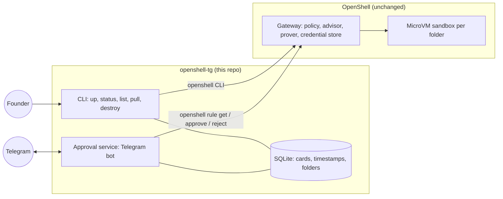
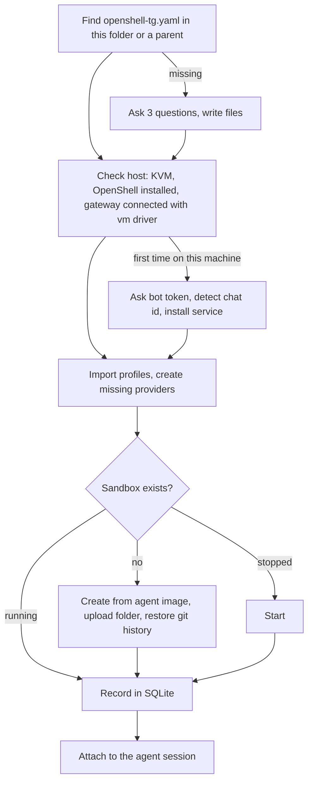
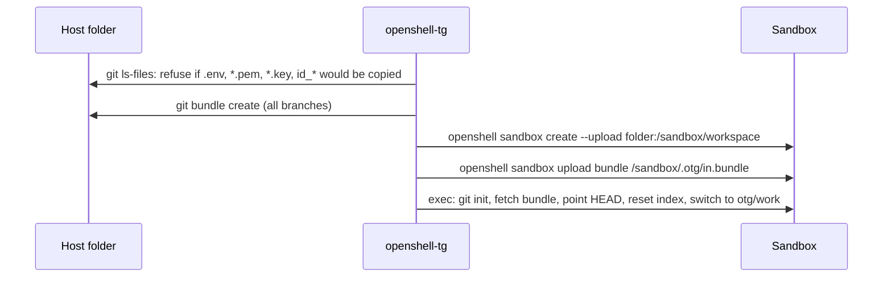
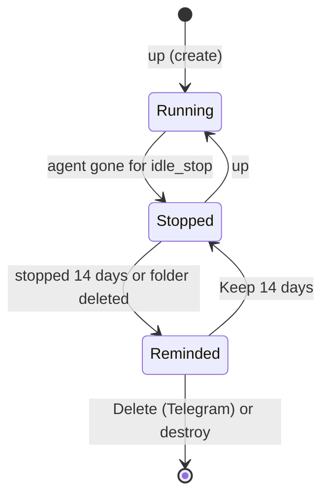
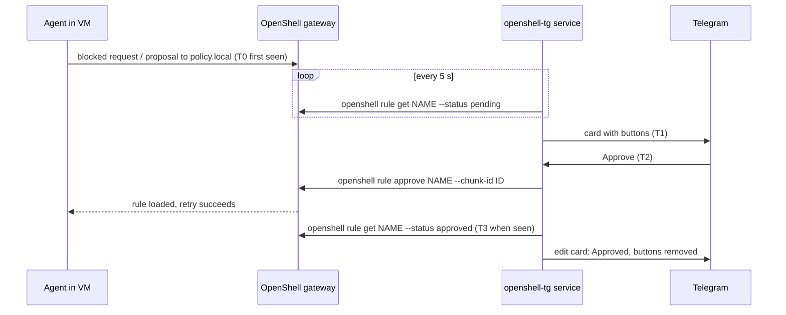
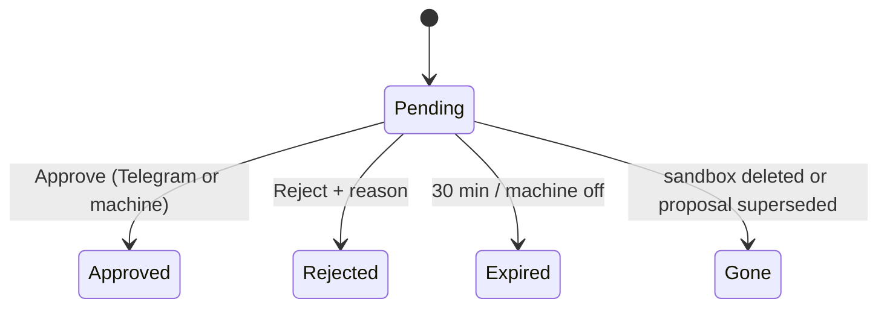

# openshell-tg design

Version 1.0 · 2026-10-15 · targets OpenShell v0.1.4, MicroVM driver

## 1. Purpose

openshell-tg lets one person run coding agents (Codex, Claude Code, OpenCode) inside an isolated OpenShell MicroVM, one sandbox per project folder, and approve the agent's new network access from Telegram.

```
cd ~/code/my-project
openshell-tg up
```

That one command sets up everything that is missing, starts the folder's sandbox, and opens the agent. Inside the sandbox the agent runs without permission prompts. When it needs a network address the policy does not allow, a card appears in Telegram with Approve and Reject buttons.

### 1.1 Rules

| Rule | Consequence |
| --- | --- |
| Add Telegram, do not extend OpenShell | openshell-tg calls only public `openshell` CLI commands. No fork, no patch, no gRPC stubs. Removing openshell-tg leaves OpenShell working as before. |
| No new rule format | Network, filesystem and credential rules are OpenShell policy YAML and provider-profile YAML. openshell-tg owns six keys in `openshell-tg.yaml`. |
| One command | `openshell-tg up` is idempotent: each step skips what already exists. |
| User-oriented | Every message is plain language with one next step. Technical detail goes to the log file only. |
| Safe by default | Unanswered requests are rejected. Code never overwrites files on the host. Secrets are never stored in plain text by openshell-tg. |

### 1.2 Out of scope

Backups, multi-user approval, quiet hours, token accounting, two-way file sync, Windows hosts, remote gateways.

## 2. Ownership boundary



| Done by OpenShell | Done by openshell-tg |
| --- | --- |
| MicroVM isolation, egress proxy, Landlock | Read `openshell-tg.yaml`, turn it into `openshell` calls |
| Policy advisor: agent proposals via `policy.local`, drafts from blocked connections, prover risk check | Show pending proposals as Telegram cards, approve or reject them |
| Credential store (AES-256-GCM) and injection | Ask for a key once, hand it to `openshell provider create` through an environment variable |
| Sandbox create, stop, start, delete, exec, upload, download; disk persists across stop/start | Idle stop, forgotten-sandbox reminders, reboot notice |
| Policy versions and logs | Response-time metrics |

## 3. Files

### 3.1 In the project folder

```
my-project/
  openshell-tg.yaml          # openshell-tg settings (no secrets)
  openshell/
    policy.yaml              # OpenShell policy, native format
    profiles/*.yaml          # optional custom provider profiles, native format
```

`openshell-tg.yaml`:

```yaml
agent: codex            # codex | claude | opencode
auth: subscription      # subscription | api_key   (opencode: api_key only)
providers: [github]     # OpenShell provider profiles to attach
policy: openshell/policy.yaml
profiles: openshell/profiles
idle_stop: 24h
# name: my-project      # optional, defaults to the folder name
```

| Key | Default | Meaning |
| --- | --- | --- |
| `agent` | required | Agent CLI started in the sandbox |
| `auth` | `subscription` | `subscription`: log in inside the VM with the agent's own device-code flow. `api_key`: key stored in the gateway, injected by OpenShell |
| `providers` | `[]` | Extra provider profiles (for example `github`, `pypi`) |
| `policy` | `openshell/policy.yaml` | Passed to `openshell sandbox create --policy` |
| `profiles` | `openshell/profiles` | Each file is imported with `openshell profile import` |
| `idle_stop` | `24h` | Stop the VM after the agent has been gone this long (`m`, `h`, `d`) |
| `name` | folder name | Readable part of the sandbox name |

CPU and memory are not per project: with the MicroVM driver OpenShell ignores `--cpu`/`--memory` and uses the gateway's `vcpus` and `mem_mib` (set once at first setup).

`up` refuses to run when any of these files contains something that looks like a key or token, and names the file and line.

### 3.2 On the host

| Path | Content | Protection |
| --- | --- | --- |
| `~/.config/openshell-tg/config.yaml` | Telegram chat id, user id, language | Not secret |
| `/etc/openshell-tg/bot-token.cred` | Telegram bot token | Encrypted with `systemd-creds` (host key, root only). Decrypted only into the service's private credentials directory |
| `/etc/systemd/system/openshell-tg.service` | Approval service, runs as the user | |
| `~/.local/state/openshell-tg/state.db` | SQLite (section 9) | Mode 0700 directory, no secrets |
| `~/.local/state/openshell-tg/openshell-tg.log` | Technical log | No secrets |
| `~/.config/openshell/gateway.toml` | Written only if absent: MicroVM driver, image, vCPUs, memory | OpenShell's own file |
| OpenShell gateway store | API keys, GitHub tokens | OpenShell, AES-256-GCM |

## 4. `openshell-tg up`



| Step | Commands used | Notes |
| --- | --- | --- |
| 1. Config | none | Questions: agent, subscription or API key, use GitHub. Writes `openshell-tg.yaml` and `openshell/policy.yaml` from templates. |
| 2. Host | `test -w /dev/kvm`, `openshell status -o json`, `openshell gateway info -o json` | Before a sandbox is created or started: free memory must cover the VM (`mem_mib` from `gateway.toml`, 8 GiB by default, plus 1 GiB) and 10 GiB of disk must be free, otherwise `up` stops with the numbers and a next step. OpenShell missing: offer to run its official installer with `OPENSHELL_VERSION` pinned. Gateway config missing: write `gateway.toml` (vm driver, agent image, 4 vCPUs, 8 GiB), run `openshell-gateway config preflight`, restart the user service, enable linger. Existing config without the vm driver: stop and explain. |
| 3. Telegram (once per machine) | Bot API | Ask the BotFather token (hidden input), call `getMe`, drop old updates, show a one-time code and wait for `/start <code>` in a private chat; take chat and user id from that message. Encrypt token with `sudo systemd-creds encrypt`, install and start the service. One sudo prompt. |
| 4. Advisor | `openshell settings set --global --key agent_policy_proposals_enabled --value true --yes` | Global, so every sandbox gets `policy.local` and the guide at `/etc/openshell/skills/policy_advisor.md`. `/AGENTS.md` is written only when the file system allows it, so the sandbox guide of openshell-tg repeats the API calls itself. |
| 5. Providers | `openshell profile import -f`, `openshell provider list -o json`, `openshell provider create --name P --type P --credential VAR` | openshell-tg ships edited copies of OpenShell's example profiles (binaries match the agent image). The secret is read with hidden input and passed as an environment variable, never on argv. |
| 6. Sandbox | `openshell sandbox get/create/start` | See section 5. |
| 7. Agent | `openshell sandbox exec NAME --workdir /sandbox/workspace -- otg-agent` | `otg-agent` (in the image) opens or re-attaches a tmux session named `agent`. |

Re-running `up` changes nothing that already matches. If `agent` or the policy file changed since the sandbox was created, `up` says so and asks whether to rebuild the sandbox. openshell-tg never runs `openshell policy set` on a running sandbox, because that would replace the rules already approved from Telegram.

## 5. Sandbox and code

### 5.1 Naming

`otg-<slug>-<hash6>`: slug from `name`, hash from the absolute folder path, so two folders with the same name never share a sandbox. The sandbox also gets the label `openshell-tg/folder=<path>`.

### 5.2 Image

`ghcr.io/phuongtuan1803/openshell-tg-agent:<version>`, built by CI from `image/Dockerfile`: Ubuntu 24.04, git, tmux, Python 3, Node 22, and pinned versions of Codex, Claude Code and OpenCode installed with npm. It also holds `otg-agent` and the sandbox `AGENTS.md` addendum. Version pins change only with an openshell-tg release.

### 5.3 Code in (first `up` only)



OpenShell's upload honours `.gitignore` but does not copy `.git`. The folder is uploaded as `.` from inside it, so its contents land directly in `/sandbox/workspace`. The bundle holds branches and HEAD only (no stash, no remote-tracking refs) and restores history so the agent commits on top of it. If secret-looking files appear anywhere in branch history, `up` lists them and asks before copying. A marker file records a finished copy; a sandbox without it is reported, not used. Uncommitted host changes arrive as uncommitted changes on `otg/work`. A folder that is not a git repository is uploaded as is and `git init` creates a first commit inside the VM.

### 5.4 Code out

| Way | When | How |
| --- | --- | --- |
| Pull request | Project has a GitHub provider | Agent pushes a branch and opens a PR within what the policy allows. Founder merges on GitHub. |
| `openshell-tg pull` | Always available | 1. In the VM: `git bundle create /sandbox/.otg/out.bundle --branches`. 2. `openshell sandbox download NAME .otg/out.bundle <tmp>`. 3. On the host: `git fetch <bundle> "+refs/heads/*:refs/heads/otg/<name>/*"`. The working tree and current branch are never touched. About 40 lines of own code; OpenShell has no commit export. |

### 5.5 Restricting the agent to one module or several repos

Native `filesystem_policy` (Landlock, applied at sandbox start):

```yaml
filesystem_policy:
  include_workdir: true
  read_only: [/sandbox/workspace]
  read_write: [/sandbox/workspace/src/payments, /sandbox/workspace/.git, /tmp]
```

Several repositories: put the checkouts in one parent folder with one `openshell-tg.yaml`. Changing the policy file needs a rebuild; `up` detects the change and asks.

### 5.6 Lifecycle



- The agent runs in tmux inside the VM. Leaving with `Ctrl-B D` keeps it working; `up` re-attaches.
- Idle: every 10 minutes the service runs `openshell sandbox exec NAME -- tmux has-session -t agent` on running sandboxes. Once the session is gone for `idle_stop`, it calls `openshell sandbox stop`. OpenShell has no idle stop of its own.
- Delete asks again when the sandbox has commits not yet pulled or pushed (checked with `git branch -r --contains` / bundle comparison).

### 5.7 Power loss while the agent works

| Kept (sandbox disk) | Lost |
| --- | --- |
| Files the agent changed, committed or not | Commands that were running (tests, installs) |
| Agent conversation history and subscription login | A file being written at the exact moment of power loss may be damaged |
| Approved rules, providers | Pending cards: closed as "Expired: machine was off" |

Next steps after the machine is back:

1. The service starts with the system and compares the kernel boot id with the last one it saw. If it changed, it sends: "The home machine restarted. The agent in *my-project* stopped. Run `openshell-tg up` in that folder to continue."
2. `up` starts the same sandbox (nothing recreated, nothing copied again). `otg-agent` resumes the last conversation (`codex resume --last`, `claude --continue`, `opencode --continue`); if that fails it starts a new session, and the sandbox `AGENTS.md` tells the agent to check `git status` first.

To verify during implementation: VM overlay disk survives an unclean host shutdown; each agent's resume works inside the sandbox.

## 6. Approval flow



- Telling the agent what the Founder decided: after a tap on Approve or Reject, if the agent's tmux window exists, the service types one line into it (`tmux send-keys -l`, then Enter), without waiting for the agent to be idle. For an approval the line is sent about 6 seconds later, because the sandbox needs a moment to load the new rule (a retry sent at once failed on a real run); it names each rule, address and programs, and asks the agent to retry, and to retry once more after 5 seconds if the connection still fails. For a rejection the line is sent at once with the reason and asks the agent not to repeat the request. The agent cannot rely on the policy.local wait call for this: it may have stopped waiting. If the window does not exist (agent not running) the card says so and that the rule is active. Expiry sends nothing. The line holds only rule name, address, programs and a fixed reason, never the agent's rationale.
- `rule get` prints text only; openshell-tg parses the `Chunk`, `Rule`, `Binary`, `Rationale`, `Security`, `Prover`, `Endpoints` and `Hits` lines. The rationale is written by the agent and may contain lines that imitate fields, so the parser fails closed: a chunk with a repeated or out-of-order field, or without `Endpoints`, is untrusted, and if the chunk count differs from the header line every chunk is untrusted. Untrusted chunks are shown as risky cards (no Approve button). The header is accepted only as the first line, any unrecognised line (including a rationale running over several lines) makes the chunk untrusted, and chunk ids must match `[A-Za-z0-9_.:-]{1,80}` before they appear in a command hint.
- Approve re-reads `rule get --status pending` and proceeds only if every chunk on the card is still pending, trusted and shows the same rule, endpoints and programs. A card closes only when every `approve`/`reject` call succeeded.
- The card shows `Binaries` (the programs the rule grants), and also `Binary` (the requester) when it differs.
- Risky card: the chunk has `Security` notes (wildcards, private IPs, unusual ports). Only Reject and Details; approving needs `openshell rule approve` on the machine.
- Expiry: 30 minutes after the proposal was first seen (T0), even if the card could not be sent, the service runs `openshell rule reject --reason "No answer within 30 minutes"`. Unsent cards are retried on every poll.
- Duplicates: same sandbox, rule, endpoints and programs while a low-risk card is open: no new card, the open card shows "×N". Risky or untrusted chunks always get their own card.
- Reject reasons (buttons): "Too broad, ask for something narrower", "Not needed for this task", "This service is not allowed". The reason goes to the agent through `--reason`.
- Revoke: `/rules` lists the rules in the active policy (`openshell policy get NAME --full -o json`) as a numbered list, 8 per page (◀ ▶ to turn pages). Tapping `Remove N` asks for confirmation on the same message; confirming runs `openshell policy update NAME --remove-rule RULE --wait` and redraws the list from the policy as it is then.
- Only messages and button presses from the configured chat and user id are accepted; everything else is ignored.

## 7. Telegram interface

### 7.1 Commands

| Command | Shows |
| --- | --- |
| `/help` | What the bot does, the commands, when to approve |
| `/list` | Every sandbox: running or stopped, last use, folder; Stop and Delete buttons |
| `/status` | Machine and service up, pending requests (resends their cards), response times for 7 days |
| `/rules [sandbox]` | Approved addresses, numbered, 8 per page, with `Remove N` buttons and a confirmation step |
| `/screen [sandbox]` | The last 15 lines of the agent's terminal (section 7.5) |

### 7.2 Card

```
Network request · Low risk
Sandbox   my-project · codex
Address   pypi.org:443
Program   /usr/bin/python3
Agent     Install requests to run the tests
Expires   18:10 (30 min)
[Approve] [Reject] [Details]
```

After a decision the same message is edited: result, response time, buttons removed. Messages are never deleted (Telegram allows bots to delete only messages younger than 48 hours). Pressing a stale button answers "Already handled".

### 7.3 Card states



Every 5 seconds and at service start, open cards are reconciled with `rule get`: a chunk decided on the machine edits its card to "Handled on the machine".

### 7.4 Other messages

| Event | Message |
| --- | --- |
| Setup finished | "Ready. Requests from my-project will appear here." |
| Host restarted | Section 5.7 |
| Sandbox stopped 14 days / folder deleted | "my-project has been stopped for 15 days." [Delete] [Keep 14 days] |
| Disk below 10% free (checked hourly) | "Disk is 90% full. Largest sandbox: my-project." [Delete] |
| Agent quiet for 2 minutes after working | "my-project: the agent has been quiet for 2 min. It may be waiting for your answer." Section 7.5 |
| Internet back after an outage | "2 requests expired while the machine was offline." |
| Service error | One plain sentence; detail in the log |

### 7.5 Agent questions and `/screen`

An agent may stop to ask the Founder a question. OpenShell has no event for this, so the service watches the terminal: every 30 s it reads the age of the last output in the agent's tmux window (`window_activity`). When a window that was working (output within 30 s) has then been quiet for 2 minutes, and no request card is open for that sandbox, the bot sends one notice with the sandbox name. The notice repeats only after the agent has worked again. The notice carries no terminal text. `/screen` sends the last 15 lines of the window (up to 3000 characters) in a pre-formatted block, with a warning that the text is visible to the chat; it is sent only on request because the terminal may show secrets.

## 8. Metrics

| Timestamp | Meaning |
| --- | --- |
| T0 | Proposal first seen by the service |
| T1 | Card sent |
| T2 | Button pressed |
| T3 | `openshell rule approve` confirmed the rule was merged |

`/status` and `openshell-tg status` show requests by result, response time (T2 − T1) median and 90th percentile, and total agent waiting time (T3 − T0) over 7 days. No targets until there is data.

## 9. State (SQLite)

| Table | Columns |
| --- | --- |
| `sandboxes` | name, folder, agent, idle_stop, created_at, last_used, stopped_at, keep_until, reminded_at |
| `requests` | sandbox, chunk_id, summary, risky, status, reason, count, message_id, t0–t3 |
| `meta` | Telegram update offset, last boot time, last disk warning |

The CLI and the service both open the database (WAL mode). Losing it loses only metrics and card links; OpenShell holds the real state.

## 10. Errors

| Situation | User sees | Behaviour |
| --- | --- | --- |
| Low memory | "Not enough free memory to start the sandbox: X GB free, Y GB needed. Close other programs or stop other sandboxes." Needed = `mem_mib` from `gateway.toml` + 1 GiB. Checked only when the sandbox is not already Ready | Stop |
| Low disk | "Not enough free disk space for the sandbox: X GB free, 10 GB needed." Checked on the OpenShell data folder | Stop |
| No KVM | "This machine cannot run virtual machines. Turn on virtualization (VT-x / AMD-V) in the BIOS, then run up again." | Stop |
| OpenShell missing | "OpenShell is not installed. Install it now? [Y/n]" | Runs the official installer |
| Gateway not connected | "OpenShell is not running. Starting it…" | `systemctl --user restart openshell-gateway`, then retry once |
| Secret in a config file | "openshell-tg.yaml line 4 looks like a key. Remove it; keys are asked for separately." | Stop |
| Secret file would be copied | ".env would be copied into the sandbox. Add it to .gitignore, then run up again." | Stop |
| Telegram unreachable | Nothing until it is back, then the expired count | Cards expire and are rejected |
| Any `openshell` failure | Step that failed, `Cause:` and `Do this:` for recognised causes (below), last lines of the error, log path | Exit 1; `up` is safe to run again |
| Image cannot be downloaded | Cause: access denied; set the package to Public | A failed create deletes the half-built sandbox |
| Sandbox in phase Error cannot start | "Delete it and create a new one?" | Deletes only the sandbox, then creates it again |
| Policy blocks `/dev/ptmx` or `/dev/pts` | Cause and the `filesystem_policy` block to add | `up` probes tmux before attaching; the templates include the block |
| Unexpected exception | "Something unexpected went wrong" and the log path | Traceback goes to the log only; exit 1 |

Recognised causes (`diagnose.py`, matched on the error text): image access denied, image missing, gateway not answering, timeout, disk full, no KVM access, wrong sandbox state, item not found. Anything else shows `Cause: not recognised` with the detail. The error text never contains secrets, because secrets travel in the environment and never in arguments.

The log is `~/.local/state/openshell-tg/openshell-tg.log`, rotated at 1 MB with 3 backups. `openshell-tg logs [-n N]` prints its last lines.

Log format: `time level [cli|serve] module: event key=value ...`. Lifecycle events are logged at INFO (`up`, `create`, `start`, `request`, `decision`, `agent told`, `idle stop`, `agent quiet`, `service started`); failures at WARNING or ERROR with the cause and the last lines of the `openshell` error; every `openshell` call at DEBUG (`OPENSHELL_TG_LOG_LEVEL=DEBUG`). Before a line is written, anything that looks like a secret (bot token, API key, bearer token, `key=value` credential) is replaced with `[hidden]`; the agent's rationale and terminal text are never logged.

## 11. Code layout

| Path | Responsibility |
| --- | --- |
| `src/openshell_tg/cli.py` | Commands `up`, `status`, `list`, `pull`, `destroy`, `logs`, hidden `serve` |
| `src/openshell_tg/logsetup.py` | Log file, line format, rotation and removal of secrets from log lines |
| `src/openshell_tg/diagnose.py` | Turns an `openshell` failure into a cause, a next step and the last lines of the error |
| `src/openshell_tg/project.py` | `openshell-tg.yaml`: load, validate, secret check, create |
| `src/openshell_tg/host.py` | KVM, memory and disk check, OpenShell install, gateway config, Telegram setup, service install |
| `src/openshell_tg/osh.py` | The only module that runs `openshell`; parses `rule get` text |
| `src/openshell_tg/sandbox.py` | Create, start, code in, attach, pull, destroy; read and type into the agent's terminal |
| `src/openshell_tg/approval.py` | Poll, cards, approve, reject, expire, reconcile, revoke, tell the agent the decision |
| `src/openshell_tg/bot.py` | Telegram loop, commands, buttons, reminders, idle stop, reboot notice, quiet-agent notice |
| `src/openshell_tg/telegram.py` | Bot API client (standard library) |
| `src/openshell_tg/store.py` | SQLite |
| `src/openshell_tg/messages.py` | All user-facing text, English and Vietnamese |
| `src/openshell_tg/templates/` | `policy.yaml` per agent and auth mode |
| `profiles/` | Provider profiles adapted from OpenShell's examples (Apache-2.0) |
| `image/` | Agent image Dockerfile, `otg-agent`, sandbox `AGENTS.md` addendum |

Dependencies: Python 3.11+, PyYAML. Tests mock the `openshell` binary with a fake script on `PATH`.

## 12. Commands

| Command | Does |
| --- | --- |
| `openshell-tg up` | Section 4 |
| `openshell-tg status` | This folder's sandbox, service state, pending requests, 7-day metrics |
| `openshell-tg list` | All sandboxes on the machine with folder, state, last use, whether the folder still exists |
| `openshell-tg pull` | Section 5.4 |
| `openshell-tg destroy` | Delete this folder's sandbox after confirmation |
| `openshell-tg logs` | Last 40 lines of the log (`-n N` for more) |

## 13. Verification before first release

1. MicroVM driver starts on the target host with the agent image from GHCR.
2. Overlay disk survives `sandbox stop/start`, gateway restart and an unclean host power-off.
3. Device-code login works for Codex and Claude Code with only the endpoints in the policy template.
4. `codex resume --last`, `claude --continue`, `opencode --continue` work in tmux inside the VM.
5. `rule get` output parser matches v0.1.4 output for an agent proposal and a mechanistic draft.
6. Profile `binaries` match the image (Codex, Claude Code and OpenCode reach their endpoints; curl does not).
7. After Approve, the line typed into the agent's tmux window reaches Claude Code and the retry succeeds (verified once with `curl` after the 6 s delay; verify again for Codex and OpenCode).
8. `window_activity` reflects output in tmux 3.4 inside the VM, so the quiet-agent notice (section 7.5) fires after 2 minutes and not while the agent is working.
9. `claude --continue` falls back to a new conversation when the last one is still running in the background (`otg-agent`).
