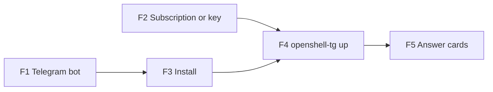

# openshell-tg runbook

Version 1.0 · 2026-10-15 · openshell-tg 0.1.0 · OpenShell v0.1.4

How to use: copy each command, run it in a terminal on the machine where the agents will run, and compare what you see with the **Expected result**. If it differs, go to [section 8](#8-when-something-goes-wrong).

Messages appear in the language chosen at first setup (English or Vietnamese). This runbook shows the English text.

## 1. Founder tasks

| # | Task | When | Done when |
| --- | --- | --- | --- |
| F1 | Prepare a Telegram bot (section 2.1) | Once, before F3 | You have the bot token |
| F2 | Prepare a subscription or an API key (section 2.2) | Once, before F4 | You can log in to ChatGPT or Claude, or you have the key |
| F3 | Install openshell-tg (section 3) | Once per machine | `openshell-tg --version` prints a version |
| F4 | Run `openshell-tg up` in a project folder (section 4) | Once per project | Telegram shows "Ready" and the agent opens |
| F5 | Answer request cards in Telegram (section 5) | Whenever a card arrives | The card shows Approved or Rejected |



## 2. Prepare

### 2.1 Telegram bot (F1)

1. In Telegram, open a chat with **@BotFather**.
2. Send `/newbot`.
3. Give it a name, for example `My agents`, then a username ending in `bot`, for example `my_agents_2026_bot`.
4. BotFather replies with a token like `1234567890:AAH…`. Keep this message; you will paste the token once in section 4.

**Expected result:** BotFather says "Done! Congratulations on your new bot" and shows the token.

Keep the token private. Anyone who has it can pretend to be your bot.

### 2.2 Subscription or API key (F2)

| Agent | Subscription | API key |
| --- | --- | --- |
| Codex | ChatGPT Plus or Pro | OpenAI API key |
| Claude Code | Claude Pro or Max | Anthropic API key |
| OpenCode | not available | OpenRouter API key |

With an API key, set a monthly spending limit on the provider's website first. openshell-tg does not count tokens.

### 2.3 Check the machine

```
grep -cE 'vmx|svm' /proc/cpuinfo
```

**Expected result:** a number greater than 0.

If it prints `0`, turn on virtualization (Intel VT-x or AMD-V) in the BIOS, then run the command again.

```
systemctl --version | head -1
```

**Expected result:** `systemd 250` or a higher number.

## 3. Install (F3)

```
sudo apt install -y pipx git
pipx ensurepath
```

Close the terminal and open a new one, then:

```
pipx install git+ssh://git@github.com/phuongtuan1803/openshell-tg.git
```

While the repository is private, this needs your GitHub SSH key on the machine. Once it is public, `git+https://github.com/phuongtuan1803/openshell-tg.git` works without a key.

```
openshell-tg --version
```

**Expected result:**

```
openshell-tg 0.1.0
```

## 4. First run in a project (F4)

```
cd ~/code/my-project
openshell-tg up
```

`up` asks only what it does not know yet. Answer as follows.

| Question | Answer |
| --- | --- |
| `Which agent? [codex / claude / opencode]` | The agent you want |
| `Log in with your subscription, or use an API key? [subscription / api_key]` | `subscription` or `api_key` (asked for codex and claude only) |
| `Should the agent be able to push branches and open pull requests on GitHub? [y/N]` | `y` only if the project is on GitHub and you have a token for it; otherwise press Enter |
| `Language for messages / Ngôn ngữ: [en / vi]` | `en` or `vi` (first time on this machine only) |
| `Paste the Telegram bot token from @BotFather (hidden):` | The token from section 2.1. Nothing appears while you paste; press Enter |
| `Open Telegram and send this to @your_bot:  /start 123456` | In Telegram, open your bot and send exactly that text, with the code shown |
| `Installing the approval service. Your computer password is needed once.` | Type your computer password |
| `OpenShell v0.1.4 is not installed. Install it now? [Y/n]` | Press Enter |
| `Anthropic: paste … (hidden, stored encrypted by OpenShell):` and similar | The key from section 2.2. Nothing appears while you paste; press Enter |

The first sandbox takes a few minutes to create.

**Expected result**, in the terminal:

```
Created openshell-tg.yaml and openshell/policy.yaml. You can commit them; they contain no keys.
Creating the sandbox and copying this folder in. The first time takes a few minutes…
Opening codex. To leave and keep it working, press Ctrl-B then D.
First time: log in with the link and code the agent shows.
```

The last line appears only with a subscription.

and in Telegram:

```
Ready. Requests from your agents will appear here. Send /help to see what I do.
```

With a subscription, the agent shows a link and a code the first time. Open the link on your phone or computer, sign in to ChatGPT or Claude, and enter the code. This happens once per sandbox.

## 5. Answering request cards (F5)

When the agent needs an internet address it is not yet allowed to use, a card arrives:

```
Network request · low risk
Sandbox: otg-my-project-1a2b3c · codex
Address: pypi.org:443
Program: /usr/bin/python3
Agent says: Install requests to run the tests
Expires: 18:10
[Approve] [Reject] [Details]
```

| What you see | What to do |
| --- | --- |
| An address you know that fits the task: package sites (pypi.org, registry.npmjs.org), documentation, your own services | **Approve** |
| An address you do not recognise, or one that is broader than needed | **Reject**, then pick a reason. The agent reads the reason |
| A card marked **check carefully** with no Approve button | **Reject**, unless you understand the warning. To approve it anyway, run the command shown on the card on the machine |
| A card you cannot answer now | Do nothing. After 30 minutes it counts as Reject |

**Expected result:** the card changes to `✅ Approved` or `❌ Rejected` and its buttons disappear.

## 6. Everyday use

| You want to | Do this | Expected result |
| --- | --- | --- |
| Continue working on a project | `cd` into the folder, run `openshell-tg up` | The agent opens where it left off |
| Leave the agent working in the background | Press `Ctrl-B`, release, then press `D` | `Left the agent. Run openshell-tg up here to come back.` |
| See what is waiting for you | Telegram `/status`, or `openshell-tg status` in the folder | Pending requests and response times |
| See all sandboxes | Telegram `/list`, or `openshell-tg list` | One line per sandbox with its state |
| Remove an approved address | Telegram `/rules`, then **Remove** next to it | `Removed` |
| Get the agent's work into your folder | `openshell-tg pull` in the folder | `otg/work: 3 commit(s) not in your current branch` |
| Delete a sandbox you no longer need | `openshell-tg destroy` in the folder, or **Delete** in `/list` | `Sandbox … deleted.` |

After `pull`, the agent's work is on the branch `otg/work` in your folder. Your own files and current branch are not changed. Look at it with `git log otg/work` and merge it when you are happy.

A sandbox stops by itself 24 hours after the agent finished, to free memory. Nothing is lost; `openshell-tg up` starts it again. After 14 days stopped, Telegram asks whether to delete it.

## 7. After a power cut or restart

1. Telegram shows: `The home machine restarted. The agent in my-project stopped.`
2. Run:

```
cd ~/code/my-project
openshell-tg up
```

**Expected result:** the agent opens and continues the last conversation. Files it had changed are still there. Commands that were running when the power went off (tests, installs) have to run again; the agent does this itself.

## 8. When something goes wrong

| Message | Do this |
| --- | --- |
| `This machine cannot run virtual machines…` | Turn on VT-x or AMD-V in the BIOS, then run `openshell-tg up` again |
| `Your user cannot use virtualization yet…` | Run the `sudo usermod` command shown, log out and back in, run `openshell-tg up` again |
| `OpenShell is set up for containers, not virtual machines…` | OpenShell was configured before. Open the file named in the message, set `compute_driver = "vm"`, run `openshell-tg up` again |
| `Telegram did not accept that bot token…` | Copy the token again from @BotFather (section 2.1) |
| `The /start message with the code did not arrive…` | Run `openshell-tg up` again and send `/start` with the new code to your bot |
| `These files would be copied into the sandbox: .env…` | Add the files to `.gitignore`, then run `openshell-tg up` again |
| `… line … looks like a key or token…` | Delete that line from the file named; keys are asked for separately |
| `Copying the folder into the sandbox did not finish…` | Run `openshell-tg destroy`, then `openshell-tg up` |
| `✗ Stopped at: openshell …` | Read the line that starts with `Cause:` and do the step on the line `Do this:`. Then run `openshell-tg up` again; it continues where it stopped |
| `Cause: … cannot download the agent image` | On GitHub, open Packages > openshell-tg-agent > Package settings, set visibility to Public, run `openshell-tg up` again |
| `Cause: OpenShell is not answering` | `systemctl --user restart openshell-gateway`, wait 10 seconds, run `openshell-tg up` again |
| `The sandbox is broken and cannot start. Delete it and create a new one?` | Type `y`. Only the sandbox is deleted; your folder is not touched |
| `Something unexpected went wrong` | Run `openshell-tg up` again. If it repeats, send the output of `openshell-tg logs` to whoever maintains your setup |
| No cards arrive in Telegram | Send `/status` to the bot. If there is no answer, run `systemctl status openshell-tg` on the machine and check that it says `active (running)` |

Show the last 40 lines of the log:

```
openshell-tg logs
```

**Expected result:** timestamped lines, newest last. Use `openshell-tg logs -n 200` for more. The file is `~/.local/state/openshell-tg/openshell-tg.log`; it never contains keys and is capped at about 4 MB.

## 9. Remove openshell-tg

1. In each project folder: `openshell-tg destroy`
2. Then:

```
sudo systemctl disable --now openshell-tg
sudo rm -rf /etc/openshell-tg /etc/systemd/system/openshell-tg.service
pipx uninstall openshell-tg
rm -rf ~/.config/openshell-tg ~/.local/state/openshell-tg
```

**Expected result:** `openshell-tg --version` prints `command not found`. OpenShell itself stays installed and keeps working.
